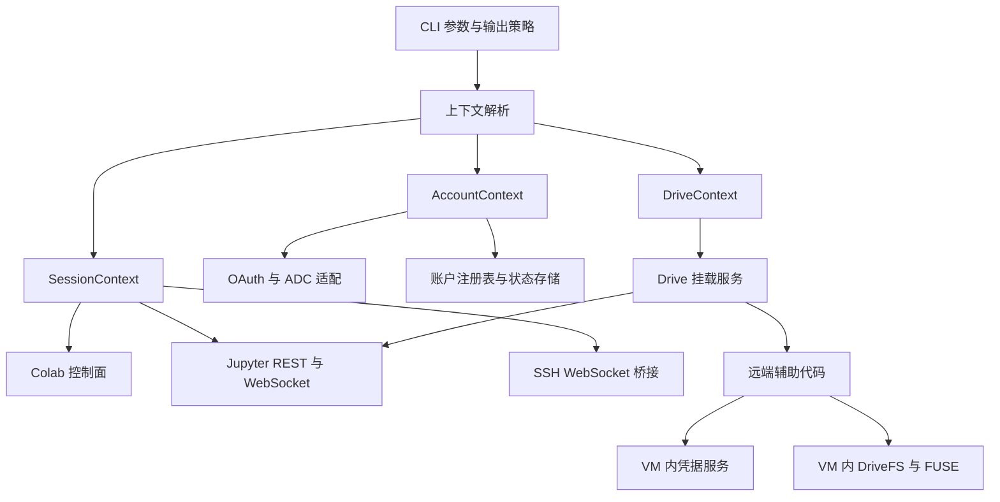

# Rust 架构与实施顺序

本文是目标设计。它采用固定基线中可观察的协议与功能，修复已识别的账户串用、危险卸载和结果未知重试问题；不照搬 Python 全局单例或 monkey-patch。

实施进度：已初始化单 Cargo package，提供账户、上下文、认证、存储基础模块、P2 会话控制面/Contents/汇总与 P3 执行核心/run/历史导出；实际模块路径、测试和未完成部分见 [09](09-foundations-implementation.md)。后续架构仍按本篇阶段推进。

## 组件边界

初期建议一个 Cargo package，按模块组织，避免在协议尚未稳定时拆出多个公共 crate。依赖方向保持从 CLI 到业务服务，再到协议和系统适配层。



| 模块 | 负责 | 不负责 |
| --- | --- | --- |
| `cli` | 参数分派、兼容别名、TTY、退出码、help | 直接调用 Google 接口 |
| `context` | 算力/Drive 账户、会话、配置路径与交互策略解析 | 持有进程级可变账户 |
| `accounts` | 注册表、绑定、重命名、迁移 | 修改进程环境来选择认证 |
| `auth` | OAuth token 生命周期、ADC provider、凭据来源 | VM 内的 google.colab.auth |
| `credential_store` | 系统凭据库与受限文件存储 | 未经请求打印凭据 |
| `colab_api` | assign/unassign、assignments、ccu-info | 执行用户代码 |
| `jupyter` | kernel REST、消息 codec、分派、执行结果 | 终端排版与账户选择 |
| `contents` | 文件路径编码、Contents 请求与响应 | 执行 shell 来替代文件 API |
| `execution` | notebook、脚本封装、环境变量、输出聚合 | 隐式重放任意用户代码 |
| `ssh` | WS 握手、stdio 桥接、OpenSSH 子进程和信号 | 自行实现远端 sshd |
| `drive` | 挂载计划、模式验证、检查、清理与结果 | 自行实现 DriveFS 内部协议 |
| `history` | JSONL、脱敏、导出 | 保存所有原始敏感 payload |
| `recovery` | 不确定操作、资源释放登记、恢复提示 | 将所有失败统一重试 |
| `supervisor` | VM 外监控、持久意图、预算、重建与恢复编排 | 保证永久防回收、默认重放任意任务 |
| `diagnostics` | doctor、依赖版本、可用性状态 | 通过自动登录掩盖缺失凭据 |

## 显式上下文

建议的数据模型示意，尚非已实现的 Rust API：

```rust
struct AccountContext {
    profile: ProfileId,
    credential_source: CredentialSource,
    paths: ProfilePaths,
    interaction: InteractionPolicy,
}

struct SessionContext {
    owner: ProfileId,
    name: String,
    endpoint: String,
    kernel_id: Option<String>,
    session_id: Option<String>,
    proxy: RuntimeProxyCredentials,
}

struct DriveContext {
    compute_owner: ProfileId,
    storage_owner: ProfileId,
    mountpoint: String,
    mode: DriveMode,
}
```

上下文一次解析后不可变地传入服务。需要刷新 token 时只更新对应凭据实例，不能切换整个应用的当前账户。命令间持久 active profile 只由 `account use` 等明确操作修改。

`SessionContext.owner` 与 `DriveContext.storage_owner` 可以不同。所有日志和资源登记同时携带账户 ID 与 endpoint，避免只凭会话名执行停止或清理。

ProfileId 需要校验路径分隔符、`.`/`..`、空串和规范化冲突；邮箱用作查询标识，不直接作为可任意拼接的文件路径。文件系统操作必须限制在配置根目录以内。

## 认证实现策略

OAuth provider 与 ADC provider 统一提供带过期时间和实际获准 scopes 的 access token，但各自保留刷新来源。系统 keyring 与文件后端通过独立接口实现；刷新需要单账户互斥，不跨账户串行阻塞。

ADC 先定义精确支持矩阵，再选择库或实现适配器。用户 refresh token、service account JWT、metadata、impersonation、external account 的凭据结构和交换流程不同，不能把一个“支持 Google OAuth”的 crate 当作已覆盖全部 ADC。

主 OAuth 与 Drive OAuth 分别存储；在 source scopes 符合要求且用户明确选择时才允许复用。默认 `drive.file` 不能视为拥有整个 Drive 的访问权限。DFS/SDK/custom client 和其 refresh token 必须保持配对。

## 异步与生命周期

普通 CLI 命令按需认证、执行、退出。新增保活与自动恢复使用用户显式启用的独立 supervisor，运行在 Colab VM 外，可前台运行或由系统服务托管；这是对上游 fire-and-forget 架构的有意扩展，详见 [生命周期规格](08-supervision-and-recovery.md)。Tokio task 在各自进程生命周期内执行，退出时显式取消并等待任务收束。

每个 Jupyter 连接建立完成后才返回 ready。一个连接使用独立 reader 和有界队列，按 channel 与 parent message ID 分派；多余输出需要落盘或施加背压，不能无上限积累。

断开客户端、删除 kernel、释放 VM 是三个独立动作。默认 close 只断开连接；restart/stop/run teardown 各自明确决定后两项。远端 DriveFS 和 shim 可以在本地 CLI 退出后继续运行，这是远端挂载服务的生命周期，不是本地 daemon。

受管 VM 另有稳定 logical ID 与可替换 generation。sessions.json 的失效裁剪不能删除恢复计划。stop 先持久化停止意图，再取消/调和并释放；仅有网络故障时不得申请替代 VM。supervisor 管理的长期任务不复用 run 的自动清理语义，需要明确所有权与检查点协议。

SSH proxy 使用二进制流，不做文本解码、换行转换或 ANSI 处理。等待 stdin、WS、子进程和信号时需防止单路关闭导致另一方向永远阻塞。清理路径幂等，不能依靠 Drop 中发起异步 HTTP。

## 错误与结果模型

| 错误类别 | 可否自动重试 | 目标行为 |
| --- | --- | --- |
| 参数/本地文件不存在 | 否 | 申请 VM 前失败 |
| 缺凭据/需用户同意 | 否 | 非交互返回结构化需要授权；交互才发起流程 |
| token 过期 | 有条件 | 对该账户刷新，原请求最多有限重试 |
| 401/403 | 有条件 | 区分过期、权限与 scope；禁止无限重新登录 |
| 分配 412 | 否 | 返回容量/前提失败，提供可读原因 |
| GET 短暂网络失败 | 有条件 | 有上限退避并支持取消 |
| assign POST 结果未知 | 不直接重发 | 使用同一 notebook identity 查询并调和 |
| execute 已发送后断线 | 否 | 返回执行结果未知，保留恢复线索 |
| kernel dead/restarting | 否 | 结束本次等待，允许用户后续重连 |
| Drive 授权失效 | 否 | 标记需重新授权，保留已授权账户归属 |
| VM 释放失败 | 有条件 | 保留待清理登记，不能仅删除本地记录 |

操作结果需要区分 `Succeeded`、`Failed`、`Unknown`，清理结果另记 `ConfirmedReleased`、`CleanupPending`。不能把“本地命令已结束”映射成“远端已经停止”。

Rust 设计建议增加受限权限的恢复日志，记录 operation ID、profile、endpoint、notebook hash、阶段、时间和不含凭据的错误。释放失败时保留记录，doctor 或显式恢复命令可再次查询。对 SIGKILL/机器断电只保证下次可恢复，不承诺当前进程一定能清理。

## 存储与升级

原有 sessions/settings/history/accounts 数据需要兼容读取；增加字段优先使用默认值或旁路文件，避免旧客户端解析失败。与 Python 同时运行时，应先验证实际锁文件及锁原语兼容，不能仅因双方都使用 flock 就认为事务互通。

第一版迁移先备份/复制、验证、再更新注册表；失败保留源数据和旧引用。账户重命名需要可恢复阶段记录，处理目录、keyring、Drive 绑定、active 指针和历史路径。`account remove --force` 是否停止 VM 必须显式设计，不能悄悄改变为破坏性操作。

发布渠道建议先支持手动安装或已有包管理器。`update --install` 的目标是安装 Rust 发行物；Python 的 pip/uv 自更新与扩展 `.pth` 修复没有原生等价操作。渠道、校验和回滚策略在实现自更新前单独定案。

## 候选依赖与验证责任

| 目的 | 候选 | 需要验证 |
| --- | --- | --- |
| CLI | [clap](https://docs.rs/clap/latest/clap/) | `--`、尾部脚本参数、重复选项、大小写与错误退出码 |
| HTTP | [reqwest](https://docs.rs/reqwest/latest/reqwest/) | TLS/代理、multipart、超时、redirect 与脱敏 |
| WebSocket | [tokio-tungstenite](https://docs.rs/tokio-tungstenite/latest/tokio_tungstenite/) | 自定义握手头、重复 query、二进制帧、ping/pong 与取消 |
| 系统凭据 | [keyring 生态](https://docs.rs/keyring/latest/keyring/) | 当前后端选择、与 Python 同一条目的互操作、锁定与超时 |
| JSON/时间/UUID | 实现时选择维护中的 Rust 库 | 原有 schema、时间精度、未知字段保留 |
| 终端编辑与高亮 | 实现时原型比较 | 多行、快捷键、中文、EOF、非 TTY 不初始化编辑器 |

以上是候选，不是已验证或锁定的依赖版本。尤其 keyring 不同主版本的后端 API 存在差异，不能照旧示例直接调用。最终 Cargo.lock、MSRV 与目标平台需要在技术原型后冻结。

## 分阶段交付

| 阶段 | 交付范围 | 进入下一阶段的条件 |
| --- | --- | --- |
| P0 证据与契约 | 本文档集、命令/协议 fixtures、差异登记 | 合并 help 与离线协议样本可重放；未知清单有编号 |
| P1 账户和基础设施 | 上下文、配置、锁、迁移、OAuth/ADC 基础 | 双账户凭据与状态完全隔离，迁移故障注入可恢复 |
| P2 控制面与文件 | assignments、new/status/stop/usage、Contents | loopback 契约通过；真实 CPU 分配/文件往返/释放通过 |
| P3 执行核心 | Jupyter、exec、notebook、run、历史导出 | 跨命令变量、输出时序、长任务、错误/中断和清理通过 |
| P4 交互与 SSH | REPL、VM auth、官方 Drive、三种 SSH 模式 | PTY/管道/ProxyCommand、退出码和信号测试通过 |
| P5 扩展 Drive | 两步授权、跨账户绑定、shim/rt、挂载生命周期 | 真正 Drive 挂载、持续刷新、只读和卸载失败保护通过 |
| P6 完整兼容与分发 | all 汇总、doctor、别名、skill、发行物 | 无未登记功能缺口，平台矩阵通过，资源清理可核验 |
| P7 新增监控与恢复 | supervisor、计划、预算、自动重建、可选检查点恢复 | V08 故障矩阵通过，真实受控回收恢复通过，stop 不再复活 |

P0 仍含运行时 fixtures 的待办，不因文档完成而自动关闭。P1 可并行于无需真实凭据的协议 codec，但所有后续线上功能都必须使用 P1 的账户上下文，避免先做单账户再整体重构。

P7 的持久计划、停止意图与 generation 数据模型需在 P1 预留；只读 supervisor 原型可在 P2 后开始，自动重建依赖 P2/P3，Drive/任务恢复依赖 P5。P7 列在兼容阶段之后用于区分新增验收，不要求所有开发严格串行。

## 估算边界

当前不提供精确工期承诺。应先通过三个原型降低不确定性：真实 OAuth 与 keyring 互操作、最小 Jupyter 执行与变量保留、真实 DriveFS shim 挂载与续期。按原型实际耗时和 ADC/Windows 的最终范围，再对各阶段估算。

“本地约一万行 Python”只反映仓库大小，不能用于线性估算 Rust 工作量；Google 认证依赖、平台差异、线上等待与故障恢复占据独立成本。
