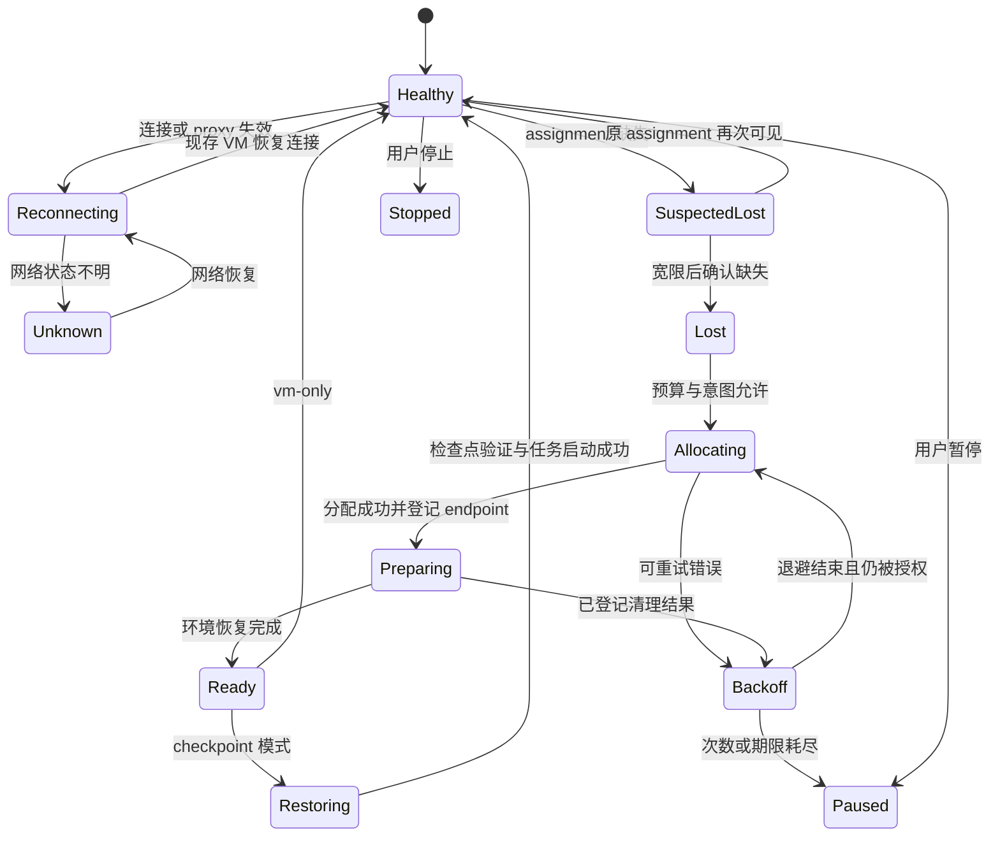

# 保活监控与 VM 自动恢复

新增需求日期：2026-11-16。本章是 Rust 客户端的新增功能设计，覆盖已启动 VM 的持续健康监控、连接维护、被回收后的自动重建，以及可选的任务恢复；尚未实现或进行线上验证。

## 能力边界与依据

Colab 会回收闲置 VM，也限制 VM 生命周期；具体限额动态变化。客户端不能承诺无限保活或永久获得同一硬件。[Google Colab FAQ](https://research.google.com/colaboratory/faq.html)

保活与恢复分为三个能力，分别验收：

| 能力 | 目标 | 不应承诺 |
| --- | --- | --- |
| 连接维护 | 发现断线、刷新凭据、重连现存 VM | WebSocket ping 或健康请求必定延长 VM 寿命 |
| VM 自动恢复 | 确认原 assignment 消失后，在所选账户申请替代 VM | 原 endpoint、临时磁盘或 Python 内存原样复活 |
| 任务恢复 | 重装依赖、挂载持久存储、从完整检查点继续 | 任意脚本自动从中断指令处继续、任意副作用只执行一次 |

### S01 上游保活的历史与当前状态

固定 CLI 的 [会话设计文档](https://github.com/googlecolab/google-colab-cli/blob/02d2321c38dd215b7804eebf78b61d98b856bcd3/docs/01_session_management.md#L12-L15) 记录：曾有保活 daemon 和不同私有接口，2026-09-25 移除了 daemon 与 ping 函数，改为根据 kernel 活动由后端维护 liveness。

这属于固定源码中的历史记录，不是当前私有保活接口有效性的证据。当前代码没有可直接移植的公开 keep-alive API。`run --keep` 仅跳过释放，不等于后台保活或自动恢复。[run 设计](https://github.com/googlecolab/google-colab-cli/blob/02d2321c38dd215b7804eebf78b61d98b856bcd3/docs/05_run_command.md#L3)

Rust 初版先提供可验证的健康探测与恢复。若后续验证出服务允许的 session lease/续约能力，单独提供可选 adapter，记录适用账户、版本、请求与效果，不将健康探测直接命名为“保证防回收”。不通过伪造用户活动或无意义计算宣称无限延长配额。

## 运行位置与生命周期

恢复控制器必须运行在被监控 VM 之外。部署选择为用户电脑、始终在线的自有服务器或用户管理的服务主机；只放在 Colab VM 内会随 VM 回收一起丢失。

第一版提供 `supervisor run` 前台常驻模式，便于观察和调试；随后支持由 systemd user service 或 launchd 托管同一 Rust 二进制。普通 CLI 仍执行后退出，supervisor 是用户显式启用的独立长期进程。系统服务注册、卸载和开机启动属于明确命令，不在创建普通会话时偷偷修改系统配置。

本机睡眠、关机或断网期间无法实时恢复。服务恢复后从持久计划调和，不一次补做错过的每次轮询。多台机器同时监控需要共享 lease/CAS 后端；初版单主机文件锁只保证同一主机上的单实例，不能宣传为分布式互斥。

## 命令草案

以下均为新增设计，没有对应的现有上游命令：

```sh
# 新建并纳入显式管理，原有 new 不默认启动 supervisor
colab -a work new -s trainer --gpu T4 --supervise --restart-on-loss

# 为已有会话建立恢复计划，plan 保存环境准备及资源预算
colab -a work watch add -s trainer --plan ./trainer-recovery.json
colab watch list --json
colab watch status trainer --json

# 在 VM 外运行；需要后台持续工作时交给系统服务托管
colab supervisor run

# 暂停恢复不释放当前 VM；stop 则先关闭恢复意图再释放 VM
colab watch pause trainer
colab watch resume trainer
colab -a work stop -s trainer
colab watch remove trainer
```

`keepalive` 可作为 `watch` 的产品别名，help 必须解释其具体能力。`watch remove` 取消计划但不释放当前 VM；需要释放则明确使用 stop。`supervisor run` 退出不自动删除所有受管 VM，也不改变持久 desired_state。

对已有 VM，先保存并展示资源规格、归属、Drive 绑定、恢复动作和预算；缺少规格的记录不能猜测重建 GPU。蓝图可以从已确认的当前状态导入，但不会自动包含用户后来在 VM 内手工安装的软件和临时文件。

## 持久计划与运行状态分离

不能只复用 sessions.json：原有 sync 会删除失效会话，而恢复计划必须在原会话消失后仍然存在。建议增加全局 supervisor 索引及每账户计划：

```text
<root>/supervisor/control.json
<root>/supervisor/leader.lock
<root>/accounts/<profile>/managed/<logical-id>/plan.json
<root>/accounts/<profile>/managed/<logical-id>/state.json
<root>/accounts/<profile>/managed/<logical-id>/events.jsonl
```

逻辑 ID 固定，endpoint/kernel ID 按重建代数 generation 变化。所有文件原子更新、包含 schema version 和修订号，权限至少 0600；不把原始 token、Drive refresh token 或脚本秘密复制进计划。

| 计划字段 | 用途 |
| --- | --- |
| logical_id / profile / session_name | 稳定身份、账户与兼容会话名 |
| desired_state | running / paused / stopped，持久化用户意图 |
| revision | 并发修改与停止竞争的 CAS 版本 |
| runtime_spec | variant、accelerator、shape 与显式允许的降级规格 |
| probe_policy | 周期、请求 deadline、连续观测与恢复宽限 |
| restart_policy | on-loss、频率/总次数上限、退避、有效期 |
| recovery_mode | vm-only / checkpoint，默认 vm-only |
| drive_binding | 固定存储账户引用，或显式选择跟随配置；默认创建时冻结 |
| bootstrap | 版本固定的文件、依赖清单、准备步骤与校验 |
| workload | 可选脚本、精确 argv、环境引用、幂等声明 |
| checkpoint | 持久位置、manifest、恢复入口、完成判定 |
| limits | 计划期限、累计受管运行时间与可观测资源预算 |

运行状态记录 generation、endpoint、kernel ID、probe 时间、错误类别、恢复阶段、allocation operation ID/nbh、重试计数、上个完整 checkpoint 和待清理资源。实际账户移除/重命名要同步这些引用；存在 running 计划时，remove 默认拒绝，force 必须先禁用计划，避免 supervisor 重建已删除账户的 VM。

## 分层健康判定

| 观测结果 | 判定 | 下一步 |
| --- | --- | --- |
| 本地无网、DNS/TLS 错误、请求超时 | Unknown | 退避；不创建替代 VM |
| OAuth 过期 | RefreshingCredential | 有限刷新；失败进入 NeedsAuth |
| proxy token 过期、Jupyter 401 | Reconnecting | 先从 assignments 更新 proxy，再重连 |
| WS 断开但 assignment 存在 | Disconnected | 重连现有 endpoint，不申请新 VM |
| kernel dead，但 assignment 存在 | KernelLost | 按独立任务策略处理；不能自动当作 VM 已回收 |
| 长任务无输出但连接健康 | Running 或 UnknownProgress | 静默本身不判死亡、不重放 |
| 成功获取完整 assignments，原 endpoint 不存在 | SuspectedLost | 经过宽限与再次成功确认后才进入 Lost |
| 授权失败、账户限制、分配被拒 | NeedsAuth / PolicyBlocked / Backoff | 保留计划并停止或受限重试 |

默认建议每 60 秒调和一次；首次缺失后至少间隔 30 秒再获取一次完整成功列表，默认连续两次缺失才触发 Lost。每次请求设置独立 deadline，轮询带 jitter。这些是产品默认建议，不是后端 SLA，也不能消除最终一致性导致的误判；确认策略必须经真实故障实验校准。

成功的旧 VM 健康结果必须匹配 profile、endpoint、generation 和当前 revision。旧连接的迟到事件不能让新 VM 被误判为失效。健康探针不能插入占据 kernel 的执行请求，不能阻塞用户长任务；优先控制面查询、连接状态与轻量 REST 状态。

## 恢复状态机



所有分配、准备、恢复边界都重新读取 desired_state/revision；上图未展开的 NeedsAuth、PolicyBlocked、CleanupPending 均是可持久化阻断状态，不能跳过它们强行进入 Healthy。

1. 原 VM 确认丢失后检查计划、期限、次数和预算。
2. 获取该逻辑 VM 的恢复锁，重新核对最新状态，禁止双 worker 同时分配。
3. 持久化本次 generation 的 nbh，调用已有 assign 调和流程；POST 超时使用同一 nbh 查询。
4. 取得 endpoint 立即落盘，再启动 kernel/Drive/依赖，不能等全部初始化后才登记。
5. 准备步骤可幂等重复，用户 workload 不能默认重放。
6. 成功后原子替换逻辑会话指向，并发布 generation 变化事件。
7. 准备失败按策略清理本代 VM；释放未确认则进入 CleanupPending，默认不继续申请下一台。

短暂缺失后旧 VM 又出现会形成双活风险。调和时先暂停新的 workload 启动，核对本计划拥有的所有代数，按预先定义策略保留一代。不能删除无法证明属于本计划的 assignment；任意外部副作用仍需业务侧幂等。

## 自动重建与任务恢复

vm-only 默认仅重建环境，不重新执行旧 exec/run 的任意用户代码。checkpoint 模式需要用户配置明确的恢复协议：

1. 用户任务周期性向持久存储写版本化 checkpoint。
2. 数据写完并校验后才发布 complete manifest；恢复只选择完整版本。
3. 重建后按顺序挂载存储、校验脚本/依赖版本、下载或读取 checkpoint。
4. 通过 resume 参数继续训练，而不是从头重放最后一次 exec。
5. 恢复事件记录丢失进度范围，不声称所有内存状态都已保留。

`/content` 是临时位置，不可作为唯一恢复来源。DriveFS 写入返回或本地 rename 不足以证明远端持久化已经完成；checkpoint 完成协议需要实际持久存储确认、校验与至少一个上个完整版本。

若任务向数据库、对象存储或外部服务产生副作用，使用 job_id、step_id、generation 及外部去重/CAS。跨进程崩溃和服务端响应丢失下，不对任意脚本承诺 exactly-once。不能仅依靠本机锁阻止失联旧 VM 的脚本继续运行。

## 停止与预算

用户 stop 的正确顺序是：先原子写 desired_state=stopped 并增加 revision，再通知 supervisor 取消本计划待办，最后释放当前及正在分配的已登记本代资源。若 POST 正在进行，结果未知仍需用同一 nbh 调和并清理；不能因 stop 先返回而丢失 endpoint。

pause 禁止重建与任务恢复，保持已有 VM；resume 显式重新评估期限与预算。用户在网页删除 VM 与后端回收可能不可区分，因此文档必须提醒：受管 VM 应通过 stop/watch pause 停止，避免用户删除后被计划重新建立。

建议默认退避从 30 秒增长到 10 分钟、带随机抖动；最多 3 次分配尝试/小时，最多 6 次/24小时，并要求计划具有显式有效期。分配失败也计入尝试预算；计数写盘，supervisor 重启不能清零。长时间离线回来不会重置预算或自动延长授权期限。

预算至少含尝试次数、代数、累计受管时间和期限。CCU 信息可辅助预警；余额有延迟且账户可能有其他任务，不能将观测差额当作精确费用或硬性金额上限。无法核验必需预算时暂停新的分配。

不因 412 或配额耗尽自动切换账户，不默认升级/降级硬件；账户和资源变更需事先列入计划。Colab 官方限制多账户绕过资源限制，恢复逻辑不以轮换账户规避限制。[Google Colab FAQ](https://research.google.com/colaboratory/faq.html)

## 实施与验收

第一步实现计划、持久状态、单主机 leader 锁、轮询与只读状态展示；第二步实现有预算的 VM 重建；第三步实现 bootstrap/Drive 恢复；最后才加入显式 checkpoint workload 恢复。系统服务托管在前台模式与崩溃恢复通过后交付。

| 编号 | 场景 | 断言 |
| --- | --- | --- |
| V08.1 | 断网、超时、401、proxy 失效 | 不误创建 VM，凭据错误进入可诊断状态 |
| V08.2 | 两次缺失、迟到响应、原 VM 又出现 | generation/revision 正确，不重复启动 workload |
| V08.3 | 两 supervisor、进程崩溃与重启 | 同主机单实例，同 nbh 调和，次数和意图不丢失 |
| V08.4 | stop 与 assign/prepare 同时发生 | stop 意图优先，晚到 endpoint 被登记并清理 |
| V08.5 | 分配成功后落盘/准备/释放失败 | 不失去 endpoint，CleanupPending 阻止继续膨胀 |
| V08.6 | 预算耗尽、auth/配额失败 | 暂停，不隐式换账户、无限重试或重新授权 |
| V08.7 | 检查点部分上传或校验失败 | 使用上个完整版本，不从损坏文件启动 |
| V08.8 | 主机睡眠、时钟回拨、重启 | 不补跑错过轮询，不重置预算，deadline 保守处理 |
| V08.9 | 用户任务静默或 kernel 忙 | 不注入阻塞执行、不凭无输出判回收 |
| V08.10 | 真实测试 VM 受控被删除 | 在指定预算内重建环境，任务仅按恢复契约继续 |

需要补充的真实证据：当前服务是否有允许且有效的续约机制、不同工作负载的回收信号、assignments 缺失的稳定性、重建权限、Drive 恢复与检查点持久化。主动删除测试 VM 验证恢复不等于证明能阻止闲置回收；两种结论必须分开。
